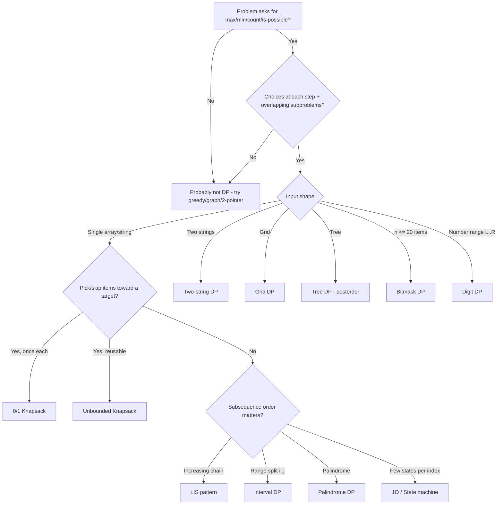
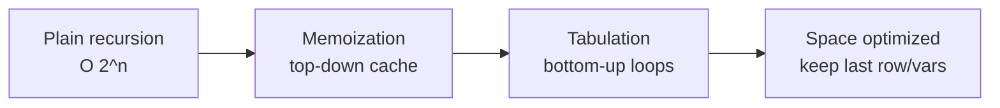
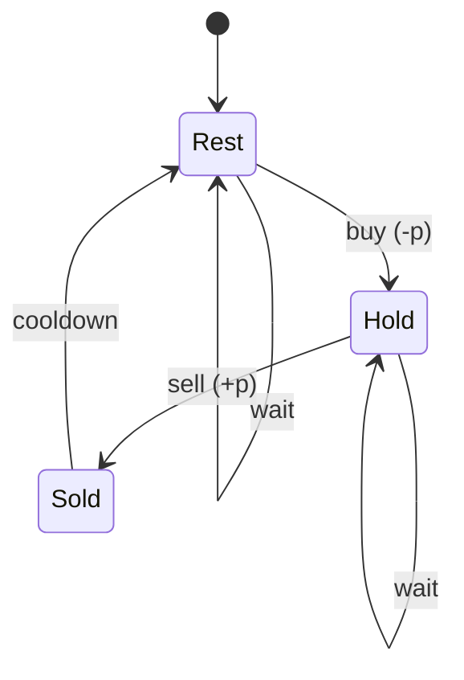

# Dynamic Programming — Interview Prep (Problems, Templates, Tricks)

> **Prerequisites:** Recursion, basic arrays/strings, Big-O. Trees & graphs needed for sections 10 and 13.
> **Legend:** ★ = must-do (core list) · LC = LeetCode number · GfG = GeeksforGeeks · E/M/H = Easy/Medium/Hard · 🔒 = LeetCode Premium
> Problem names are clickable links to LeetCode / GfG.

---

## Topic Map

| # | Pattern | Recognize it when… |
|---|---------|--------------------|
| 1 | 1D / Linear DP | Answer at `i` depends on a few previous indices |
| 2 | 0/1 Knapsack | Each item used **at most once**, capacity/target given |
| 3 | Unbounded Knapsack | Items can be reused (coins, rod pieces) |
| 4 | Grid DP | Move right/down (or limited directions) on a matrix |
| 5 | LIS family | "Longest increasing / chain / nested" subsequence |
| 6 | Two-string DP | Two strings/arrays compared (LCS, edit distance) |
| 7 | Palindrome DP | Substring/subsequence palindromes |
| 8 | Interval / Partition (MCM) | "Split range `[i..j]` at `k`", merge cost, burst, cut |
| 9 | State machine (Stocks) | Each day you are in one of few states (hold / not hold / cooldown) |
| 10 | DP on Trees | Answer for a node computed from its children |
| 11 | Bitmask DP | `n ≤ 20`, "visit all / assign all" subsets |
| 12 | Digit DP | "Count numbers in `[L, R]` with digit property" |
| 13 | DP on DAG / Graph | Longest path, paths with ≤ K edges |
| 14 | Game DP / Misc | Two players play optimally; Kadane-type |



---

## 0. The Universal 4-Step Recipe

Every DP problem is solved the same way. Do these in order in an interview — it shows structured thinking.

1. **Define the state** — "`dp[i]` = answer for the first `i` elements / ending at `i` / starting at `i`". Write it in one English sentence.
2. **Write the recurrence** — Think about the **last choice** (or first choice) made: `dp[i] = best over choices (dp[smaller] + cost)`.
3. **Base cases** — smallest inputs (empty string, `i = 0`, amount `0`).
4. **Order & answer** — which direction to fill so dependencies are ready; where the final answer lives (`dp[n]`, `max(dp)`, `dp[0][n-1]`).

Then evolve: **Recursion → Memoization → Tabulation → Space optimization.**



Recursion tree for `fib(5)` — repeated nodes = overlapping subproblems = why caching helps:

```
                 fib(5)
               /        \
          fib(4)         fib(3)   <- computed again
         /     \         /    \
     fib(3)  fib(2)  fib(2) fib(1)
     /   \
 fib(2) fib(1)
```

---

## 1. Generic Templates (Java)

### 1.1 Top-down (memoization)

```java
import java.util.*;

class TopDown {
    private int[] memo;          // or Integer[] memo to use null as "not computed"

    int solve(int[] nums) {
        memo = new int[nums.length];
        Arrays.fill(memo, -1);   // -1 only safe if -1 is never a valid answer
        return dfs(nums, 0);
    }

    private int dfs(int[] nums, int i) {
        if (i >= nums.length) return 0;          // base case
        if (memo[i] != -1) return memo[i];       // cache hit
        int take = nums[i] + dfs(nums, i + 2);   // choice 1
        int skip = dfs(nums, i + 1);             // choice 2
        return memo[i] = Math.max(take, skip);
    }
}
```

### 1.2 Bottom-up (tabulation)

```java
int robTab(int[] nums) {
    int n = nums.length;
    int[] dp = new int[n + 2];                  // padding avoids bounds checks
    for (int i = n - 1; i >= 0; i--) {          // fill in reverse of recursion direction
        dp[i] = Math.max(nums[i] + dp[i + 2], dp[i + 1]);
    }
    return dp[0];
}
```

### 1.3 Space optimized

```java
int robOpt(int[] nums) {
    int prev2 = 0, prev1 = 0;                   // dp[i-2], dp[i-1]
    for (int x : nums) {
        int cur = Math.max(prev1, prev2 + x);
        prev2 = prev1;
        prev1 = cur;
    }
    return prev1;
}
```

### 1.4 Multi-dimensional memo with a map (when state is awkward)

```java
Map<String, Integer> memo = new HashMap<>();
int dfs(int i, int j, int k) {
    String key = i + "," + j + "," + k;         // or encode: ((long)i << 40) | ((long)j << 20) | k
    if (memo.containsKey(key)) return memo.get(key);
    int res = 0; /* ... */
    memo.put(key, res);
    return res;
}
```

---

## 2. Pattern-wise Problem List + Template

### Pattern 1 — 1D / Linear DP

**Template:** `dp[i] = f(dp[i-1], dp[i-2], ...)`

| ★ | Problem | LC | Lvl | Key idea |
|---|---------|----|-----|----------|
| ★ | [Climbing Stairs](https://leetcode.com/problems/climbing-stairs/) | 70 | E | `dp[i] = dp[i-1] + dp[i-2]` |
| | [N-th Tribonacci Number](https://leetcode.com/problems/n-th-tribonacci-number/) | 1137 | E | 3 previous terms |
| ★ | [Min Cost Climbing Stairs](https://leetcode.com/problems/min-cost-climbing-stairs/) | 746 | E | `dp[i] = cost[i] + min(dp[i-1], dp[i-2])` |
| ★ | [House Robber](https://leetcode.com/problems/house-robber/) | 198 | M | take `i` + `dp[i-2]` vs skip |
| ★ | [House Robber II (circular)](https://leetcode.com/problems/house-robber-ii/) | 213 | M | run twice: `[0..n-2]` and `[1..n-1]` |
| | [Delete and Earn](https://leetcode.com/problems/delete-and-earn/) | 740 | M | bucket by value → House Robber |
| ★ | [Decode Ways](https://leetcode.com/problems/decode-ways/) | 91 | M | 1-digit + 2-digit transitions, careful with `'0'` |
| ★ | [Word Break](https://leetcode.com/problems/word-break/) | 139 | M | `dp[i] = any dp[j] && dict has s[j..i)` |
| ★ | [Maximum Subarray (Kadane)](https://leetcode.com/problems/maximum-subarray/) | 53 | M | `cur = max(x, cur + x)` |
| ★ | [Maximum Product Subarray](https://leetcode.com/problems/maximum-product-subarray/) | 152 | M | track both max and min (negatives flip) |
| | [Jump Game](https://leetcode.com/problems/jump-game/) / [Jump Game II](https://leetcode.com/problems/jump-game-ii/) | 55 / 45 | M | DP works; greedy is optimal |
| | [Minimum Cost For Tickets](https://leetcode.com/problems/minimum-cost-for-tickets/) | 983 | M | `dp[day]` with 1/7/30 look-back |
| | [Domino and Tromino Tiling](https://leetcode.com/problems/domino-and-tromino-tiling/) | 790 | M | `dp[n] = 2*dp[n-1] + dp[n-3]` |
| | [Knight Dialer](https://leetcode.com/problems/knight-dialer/) | 935 | M | `dp[digit]` per step, adjacency of keypad |
| | [Paint House](https://leetcode.com/problems/paint-house/) 🔒 / [Paint Fence](https://www.geeksforgeeks.org/problems/painting-the-fence3727/1) | 256 / 276 | M | state = last colour |

---

### Pattern 2 — 0/1 Knapsack (each item once)

**State:** `dp[i][w]` = best using first `i` items with capacity `w`.
**Recurrence:** `dp[i][w] = max(dp[i-1][w], val[i] + dp[i-1][w - wt[i]])`

```java
int knapsack01(int[] wt, int[] val, int W) {
    int[] dp = new int[W + 1];
    for (int i = 0; i < wt.length; i++) {
        for (int w = W; w >= wt[i]; w--) {      // REVERSE loop => each item used once
            dp[w] = Math.max(dp[w], val[i] + dp[w - wt[i]]);
        }
    }
    return dp[W];
}

// Subset-sum feasibility variant
boolean canPartition(int[] nums) {             // LC 416
    int sum = Arrays.stream(nums).sum();
    if (sum % 2 != 0) return false;
    int target = sum / 2;
    boolean[] dp = new boolean[target + 1];
    dp[0] = true;
    for (int x : nums)
        for (int s = target; s >= x; s--)
            dp[s] |= dp[s - x];
    return dp[target];
}
```

| ★ | Problem | LC | Lvl | Key idea |
|---|---------|----|-----|----------|
| ★ | [0/1 Knapsack](https://www.geeksforgeeks.org/problems/0-1-knapsack-problem0945/1) | GfG | M | base template |
| ★ | [Subset Sum](https://www.geeksforgeeks.org/problems/subset-sum-problem-1611555638/1) | GfG | M | boolean dp |
| ★ | [Partition Equal Subset Sum](https://leetcode.com/problems/partition-equal-subset-sum/) | 416 | M | subset sum = total/2 |
| | [Count Subsets with Sum K (Perfect Sum)](https://www.geeksforgeeks.org/problems/perfect-sum-problem5633/1) | GfG | M | `dp[s] += dp[s-x]`; careful with zeros |
| | [Minimum Subset Sum Difference](https://www.geeksforgeeks.org/problems/minimum-sum-partition3317/1) | GfG | H | find all reachable sums ≤ total/2 |
| ★ | [Target Sum](https://leetcode.com/problems/target-sum/) | 494 | M | reduce to count subsets with sum `(total + target)/2` |
| | [Last Stone Weight II](https://leetcode.com/problems/last-stone-weight-ii/) | 1049 | M | same as min subset difference |
| | [Ones and Zeroes](https://leetcode.com/problems/ones-and-zeroes/) | 474 | M | 2D capacity (zeros, ones), both loops reversed |
| | [Profitable Schemes](https://leetcode.com/problems/profitable-schemes/) | 879 | H | capacity + profit cap at `minProfit` |

---

### Pattern 3 — Unbounded Knapsack (items reusable)

**Only change vs 0/1:** loop capacity **forward**.

```java
int coinChangeMin(int[] coins, int amount) {   // LC 322
    int[] dp = new int[amount + 1];
    Arrays.fill(dp, amount + 1);               // "infinity" that won't overflow
    dp[0] = 0;
    for (int a = 1; a <= amount; a++)
        for (int c : coins)
            if (c <= a) dp[a] = Math.min(dp[a], dp[a - c] + 1);
    return dp[amount] > amount ? -1 : dp[amount];
}

int coinChangeWays(int[] coins, int amount) {  // LC 518 - COMBINATIONS
    int[] dp = new int[amount + 1];
    dp[0] = 1;
    for (int c : coins)                         // coins OUTER
        for (int a = c; a <= amount; a++)       // forward => reuse allowed
            dp[a] += dp[a - c];
    return dp[amount];
}

int combinationSum4(int[] nums, int target) {  // LC 377 - PERMUTATIONS (order matters)
    int[] dp = new int[target + 1];
    dp[0] = 1;
    for (int a = 1; a <= target; a++)           // amount OUTER
        for (int x : nums)
            if (x <= a) dp[a] += dp[a - x];
    return dp[target];
}
```

| ★ | Problem | LC | Lvl | Key idea |
|---|---------|----|-----|----------|
| ★ | [Coin Change (min coins)](https://leetcode.com/problems/coin-change/) | 322 | M | min + 1 |
| ★ | [Coin Change II (ways)](https://leetcode.com/problems/coin-change-ii/) | 518 | M | coins outer = combinations |
| ★ | [Combination Sum IV](https://leetcode.com/problems/combination-sum-iv/) | 377 | M | amount outer = permutations |
| | [Rod Cutting](https://www.geeksforgeeks.org/problems/rod-cutting0840/1) | GfG | M | unbounded knapsack with length = weight |
| | [Perfect Squares](https://leetcode.com/problems/perfect-squares/) | 279 | M | coins = squares |
| | [Integer Break](https://leetcode.com/problems/integer-break/) | 343 | M | `dp[i] = max(j * max(i-j, dp[i-j]))` |

---

### Pattern 4 — Grid DP

**Template:** `dp[r][c] = grid[r][c] + best(dp[r-1][c], dp[r][c-1])`

```java
int minPathSum(int[][] g) {                     // LC 64, 1D rolling row
    int m = g.length, n = g[0].length;
    int[] dp = new int[n];
    Arrays.fill(dp, Integer.MAX_VALUE);
    dp[0] = 0;
    for (int r = 0; r < m; r++) {
        dp[0] += g[r][0];
        for (int c = 1; c < n; c++)
            dp[c] = g[r][c] + Math.min(dp[c], dp[c - 1]);   // dp[c]=from top, dp[c-1]=from left
    }
    return dp[n - 1];
}
```

| ★ | Problem | LC | Lvl | Key idea |
|---|---------|----|-----|----------|
| ★ | [Unique Paths](https://leetcode.com/problems/unique-paths/) | 62 | M | sum of top + left (also `C(m+n-2, m-1)`) |
| ★ | [Unique Paths II (obstacles)](https://leetcode.com/problems/unique-paths-ii/) | 63 | M | obstacle cell = 0 |
| ★ | [Minimum Path Sum](https://leetcode.com/problems/minimum-path-sum/) | 64 | M | template above |
| ★ | [Triangle](https://leetcode.com/problems/triangle/) | 120 | M | bottom-up from last row → `O(n)` space |
| | [Minimum Falling Path Sum](https://leetcode.com/problems/minimum-falling-path-sum/) | 931 | M | 3 parents per cell |
| ★ | [Maximal Square](https://leetcode.com/problems/maximal-square/) | 221 | M | `1 + min(top, left, diag)` |
| | [Count Square Submatrices with All Ones](https://leetcode.com/problems/count-square-submatrices-with-all-ones/) | 1277 | M | same recurrence, sum all |
| | [Maximal Rectangle](https://leetcode.com/problems/maximal-rectangle/) | 85 | H | histogram per row + stack |
| | [Dungeon Game](https://leetcode.com/problems/dungeon-game/) | 174 | H | fill **from bottom-right** (need min health) |
| | [Cherry Pickup II](https://leetcode.com/problems/cherry-pickup-ii/) | 1463 | H | two robots: `dp[row][c1][c2]` |
| | [Cherry Pickup](https://leetcode.com/problems/cherry-pickup/) | 741 | H | two people at once: `dp[t][r1][r2]` |
| | [Out of Boundary Paths](https://leetcode.com/problems/out-of-boundary-paths/) | 576 | M | `dp[move][r][c]` |
| | [Knight Probability in Chessboard](https://leetcode.com/problems/knight-probability-in-chessboard/) | 688 | M | probability DP over moves |

---

### Pattern 5 — LIS (Longest Increasing Subsequence) family

```java
int lisQuadratic(int[] a) {                     // O(n^2) - needed when you count or reconstruct
    int n = a.length, best = 1;
    int[] dp = new int[n];                      // dp[i] = LIS ENDING at i
    Arrays.fill(dp, 1);
    for (int i = 1; i < n; i++)
        for (int j = 0; j < i; j++)
            if (a[j] < a[i]) dp[i] = Math.max(dp[i], dp[j] + 1);
    for (int x : dp) best = Math.max(best, x);
    return best;
}

int lisNLogN(int[] a) {                         // O(n log n) - patience sorting
    int[] tails = new int[a.length];            // tails[k] = smallest tail of an IS of length k+1
    int size = 0;
    for (int x : a) {
        int lo = 0, hi = size;
        while (lo < hi) {                       // lower_bound (first >= x) => strictly increasing
            int mid = (lo + hi) >>> 1;
            if (tails[mid] < x) lo = mid + 1; else hi = mid;
        }
        tails[lo] = x;
        if (lo == size) size++;
    }
    return size;                                // tails[] is NOT the actual LIS
}
```

| ★ | Problem | LC | Lvl | Key idea |
|---|---------|----|-----|----------|
| ★ | [Longest Increasing Subsequence](https://leetcode.com/problems/longest-increasing-subsequence/) | 300 | M | both templates |
| | [Number of LIS](https://leetcode.com/problems/number-of-longest-increasing-subsequence/) | 673 | M | track `len[i]` and `count[i]` |
| ★ | [Russian Doll Envelopes](https://leetcode.com/problems/russian-doll-envelopes/) | 354 | H | sort width asc, height **desc**, LIS on height |
| | [Largest Divisible Subset](https://leetcode.com/problems/largest-divisible-subset/) | 368 | M | sort, LIS with `%`, reconstruct via parent[] |
| | [Longest String Chain](https://leetcode.com/problems/longest-string-chain/) | 1048 | M | sort by length, map word → best |
| | [Maximum Length of Pair Chain](https://leetcode.com/problems/maximum-length-of-pair-chain/) | 646 | M | LIS or greedy by end |
| | [Longest Bitonic Subsequence](https://www.geeksforgeeks.org/problems/longest-bitonic-subsequence0824/1) | GfG | M | LIS from left + LIS from right − 1 |
| | [Longest Arithmetic Subsequence](https://leetcode.com/problems/longest-arithmetic-subsequence/) | 1027 | M | `dp[i]` = map diff → length |

---

### Pattern 6 — Two-String DP (LCS family)

**State:** `dp[i][j]` = answer for `s1[0..i)` and `s2[0..j)`. Size `(m+1) x (n+1)`; row/col 0 = empty string.

```java
int lcs(String a, String b) {                   // LC 1143
    int m = a.length(), n = b.length();
    int[][] dp = new int[m + 1][n + 1];
    for (int i = 1; i <= m; i++)
        for (int j = 1; j <= n; j++)
            dp[i][j] = a.charAt(i - 1) == b.charAt(j - 1)
                    ? dp[i - 1][j - 1] + 1
                    : Math.max(dp[i - 1][j], dp[i][j - 1]);
    return dp[m][n];
}

int editDistance(String a, String b) {          // LC 72
    int m = a.length(), n = b.length();
    int[][] dp = new int[m + 1][n + 1];
    for (int i = 0; i <= m; i++) dp[i][0] = i;  // delete all
    for (int j = 0; j <= n; j++) dp[0][j] = j;  // insert all
    for (int i = 1; i <= m; i++)
        for (int j = 1; j <= n; j++)
            dp[i][j] = a.charAt(i - 1) == b.charAt(j - 1)
                    ? dp[i - 1][j - 1]
                    : 1 + Math.min(dp[i - 1][j - 1],              // replace
                          Math.min(dp[i - 1][j], dp[i][j - 1]));  // delete, insert
    return dp[m][n];
}
```

| ★ | Problem | LC | Lvl | Key idea |
|---|---------|----|-----|----------|
| ★ | [Longest Common Subsequence](https://leetcode.com/problems/longest-common-subsequence/) | 1143 | M | base template |
| ★ | [Longest Common Substring](https://www.geeksforgeeks.org/problems/longest-common-substring1452/1) / [Max Repeated Subarray](https://leetcode.com/problems/maximum-length-of-repeated-subarray/) | 718 | M | on mismatch `dp = 0`, track global max |
| ★ | [Edit Distance](https://leetcode.com/problems/edit-distance/) | 72 | M | 3 operations |
| | [Delete Operation for Two Strings](https://leetcode.com/problems/delete-operation-for-two-strings/) | 583 | M | `m + n − 2·LCS` |
| | [Minimum ASCII Delete Sum](https://leetcode.com/problems/minimum-ascii-delete-sum-for-two-strings/) | 712 | M | LCS weighted by ASCII |
| | [Shortest Common Supersequence](https://leetcode.com/problems/shortest-common-supersequence/) | 1092 | H | build LCS table, walk back to construct |
| ★ | [Distinct Subsequences](https://leetcode.com/problems/distinct-subsequences/) | 115 | H | match: `dp[i-1][j-1] + dp[i-1][j]` |
| | [Interleaving String](https://leetcode.com/problems/interleaving-string/) | 97 | M | `dp[i][j]` from `s1[i-1]` or `s2[j-1]` |
| ★ | [Wildcard Matching](https://leetcode.com/problems/wildcard-matching/) | 44 | H | `*` → `dp[i-1][j] || dp[i][j-1]` |
| ★ | [Regular Expression Matching](https://leetcode.com/problems/regular-expression-matching/) | 10 | H | `x*` → zero (`dp[i][j-2]`) or one-more |
| | [Is Subsequence](https://leetcode.com/problems/is-subsequence/) | 392 | E | two pointers; DP for follow-up |

---

### Pattern 7 — Palindrome DP

```java
// isPal[i][j]: fill by increasing length, or i from n-1 down to 0
int countPalSubstrings(String s) {              // LC 647
    int n = s.length(), count = 0;
    boolean[][] pal = new boolean[n][n];
    for (int i = n - 1; i >= 0; i--)
        for (int j = i; j < n; j++) {
            pal[i][j] = s.charAt(i) == s.charAt(j) && (j - i < 2 || pal[i + 1][j - 1]);
            if (pal[i][j]) count++;
        }
    return count;
}
```

Trick: **Longest Palindromic Subsequence(s) = LCS(s, reverse(s))**. Min insertions/deletions to make palindrome = `n − LPS`.

| ★ | Problem | LC | Lvl | Key idea |
|---|---------|----|-----|----------|
| ★ | [Longest Palindromic Substring](https://leetcode.com/problems/longest-palindromic-substring/) | 5 | M | expand-around-center `O(n²)` / O(1) space |
| ★ | [Palindromic Substrings](https://leetcode.com/problems/palindromic-substrings/) | 647 | M | template above |
| ★ | [Longest Palindromic Subsequence](https://leetcode.com/problems/longest-palindromic-subsequence/) | 516 | M | `dp[i][j]` interval or LCS with reverse |
| | [Min Insertion Steps to Make Palindrome](https://leetcode.com/problems/minimum-insertion-steps-to-make-a-string-palindrome/) | 1312 | H | `n − LPS` |
| ★ | [Palindrome Partitioning II (min cuts)](https://leetcode.com/problems/palindrome-partitioning-ii/) | 132 | H | `isPal` table + `cuts[i]` 1D |
| | [Palindrome Partitioning (all)](https://leetcode.com/problems/palindrome-partitioning/) | 131 | M | backtracking + `isPal` table |

---

### Pattern 8 — Interval / Partition DP (Matrix Chain Multiplication)

**State:** `dp[i][j]` = best answer for sub-range `i..j`.
**Recurrence:** try every split `k`: `dp[i][j] = best(dp[i][k] + dp[k+1][j] + cost(i,k,j))`.
**Order:** by **increasing length** (small intervals first).

```java
int matrixChain(int[] dims) {                   // matrices i has size dims[i-1] x dims[i]
    int n = dims.length - 1;                    // number of matrices, 1-indexed 1..n
    int[][] dp = new int[n + 1][n + 1];
    for (int len = 2; len <= n; len++) {
        for (int i = 1; i + len - 1 <= n; i++) {
            int j = i + len - 1;
            dp[i][j] = Integer.MAX_VALUE;
            for (int k = i; k < j; k++) {
                int cost = dp[i][k] + dp[k + 1][j] + dims[i - 1] * dims[k] * dims[j];
                dp[i][j] = Math.min(dp[i][j], cost);
            }
        }
    }
    return dp[1][n];
}

int burstBalloons(int[] nums) {                 // LC 312 - k is the LAST balloon burst in (i, j)
    int n = nums.length;
    int[] a = new int[n + 2];
    a[0] = a[n + 1] = 1;
    for (int i = 0; i < n; i++) a[i + 1] = nums[i];
    int[][] dp = new int[n + 2][n + 2];         // dp[i][j] = best for OPEN interval (i, j)
    for (int len = 2; len <= n + 1; len++)
        for (int i = 0; i + len <= n + 1; i++) {
            int j = i + len;
            for (int k = i + 1; k < j; k++)
                dp[i][j] = Math.max(dp[i][j], dp[i][k] + dp[k][j] + a[i] * a[k] * a[j]);
        }
    return dp[0][n + 1];
}
```

| ★ | Problem | LC | Lvl | Key idea |
|---|---------|----|-----|----------|
| ★ | [Matrix Chain Multiplication](https://www.geeksforgeeks.org/problems/matrix-chain-multiplication0303/1) | GfG | H | base template |
| ★ | [Burst Balloons](https://leetcode.com/problems/burst-balloons/) | 312 | H | think "last to burst", pad with 1s |
| ★ | [Minimum Cost to Cut a Stick](https://leetcode.com/problems/minimum-cost-to-cut-a-stick/) | 1547 | H | sort cuts, add 0 and n, MCM |
| | [Minimum Score Triangulation of Polygon](https://leetcode.com/problems/minimum-score-triangulation-of-polygon/) | 1039 | M | MCM on vertices |
| | [Boolean Parenthesization](https://www.geeksforgeeks.org/problems/boolean-parenthesization5610/1) | GfG | H | `dp[i][j][true/false]` counts |
| | [Partition Array for Maximum Sum](https://leetcode.com/problems/partition-array-for-maximum-sum/) | 1043 | M | 1D partition: last block size ≤ k |
| | [Strange Printer](https://leetcode.com/problems/strange-printer/) | 664 | H | merge equal chars on split |
| | [Stone Game VII](https://leetcode.com/problems/stone-game-vii/) / [Minimum Cost to Merge Stones](https://leetcode.com/problems/minimum-cost-to-merge-stones/) | 1690 / 1000 | H | prefix sums + interval |

---

### Pattern 9 — State Machine (Buy & Sell Stock)

Think: at each day you are in a **state** (holding stock or not; transactions used; cooldown).

```java
// General: at most k transactions (LC 188). k = 1 -> LC 121, k = 2 -> LC 123, k = inf -> LC 122
int maxProfit(int k, int[] prices) {
    int[] buy = new int[k + 1], sell = new int[k + 1];
    Arrays.fill(buy, Integer.MIN_VALUE / 2);    // avoid overflow when adding price
    for (int p : prices)
        for (int t = 1; t <= k; t++) {
            buy[t]  = Math.max(buy[t],  sell[t - 1] - p);   // buy uses one more transaction
            sell[t] = Math.max(sell[t], buy[t] + p);
        }
    return sell[k];
}

// Cooldown (LC 309): three states
int maxProfitCooldown(int[] prices) {
    int hold = Integer.MIN_VALUE / 2, sold = 0, rest = 0;
    for (int p : prices) {
        int prevSold = sold;
        sold = hold + p;
        hold = Math.max(hold, rest - p);
        rest = Math.max(rest, prevSold);
    }
    return Math.max(sold, rest);
}
```



| ★ | Problem | LC | Lvl | Key idea |
|---|---------|----|-----|----------|
| ★ | [Best Time to Buy & Sell Stock](https://leetcode.com/problems/best-time-to-buy-and-sell-stock/) | 121 | E | track min so far |
| ★ | [Stock II (unlimited)](https://leetcode.com/problems/best-time-to-buy-and-sell-stock-ii/) | 122 | M | sum all positive diffs |
| ★ | [Stock III (2 transactions)](https://leetcode.com/problems/best-time-to-buy-and-sell-stock-iii/) | 123 | H | 4 variables |
| ★ | [Stock IV (k transactions)](https://leetcode.com/problems/best-time-to-buy-and-sell-stock-iv/) | 188 | H | template; if `k ≥ n/2` treat as unlimited |
| ★ | [Stock with Cooldown](https://leetcode.com/problems/best-time-to-buy-and-sell-stock-with-cooldown/) | 309 | M | 3 states |
| | [Stock with Transaction Fee](https://leetcode.com/problems/best-time-to-buy-and-sell-stock-with-transaction-fee/) | 714 | M | subtract fee on sell |

---

### Pattern 10 — DP on Trees

**Template:** postorder DFS; each node returns a small array/tuple of states to its parent.

```java
class TreeNode { int val; TreeNode left, right; }

int rob(TreeNode root) {                        // LC 337
    int[] r = dfs(root);
    return Math.max(r[0], r[1]);
}
private int[] dfs(TreeNode node) {              // [0] = not robbed, [1] = robbed
    if (node == null) return new int[]{0, 0};
    int[] L = dfs(node.left), R = dfs(node.right);
    int notRob = Math.max(L[0], L[1]) + Math.max(R[0], R[1]);
    int robIt  = node.val + L[0] + R[0];
    return new int[]{notRob, robIt};
}

// "Global answer through node, return single branch upward" pattern (LC 124, 543)
int best = Integer.MIN_VALUE;
int gain(TreeNode n) {
    if (n == null) return 0;
    int l = Math.max(0, gain(n.left)), r = Math.max(0, gain(n.right));
    best = Math.max(best, n.val + l + r);       // path bending at n
    return n.val + Math.max(l, r);              // parent can extend only one side
}
```

| ★ | Problem | LC | Lvl | Key idea |
|---|---------|----|-----|----------|
| ★ | [House Robber III](https://leetcode.com/problems/house-robber-iii/) | 337 | M | rob / not-rob pair |
| ★ | [Binary Tree Maximum Path Sum](https://leetcode.com/problems/binary-tree-maximum-path-sum/) | 124 | H | global best + return one branch |
| ★ | [Diameter of Binary Tree](https://leetcode.com/problems/diameter-of-binary-tree/) | 543 | E | same as above with heights |
| ★ | [Unique Binary Search Trees](https://leetcode.com/problems/unique-binary-search-trees/) | 96 | M | Catalan: `dp[n] = Σ dp[i-1]·dp[n-i]` |
| | [Unique BSTs II](https://leetcode.com/problems/unique-binary-search-trees-ii/) | 95 | M | memo on `(lo, hi)` returning lists |
| | [Binary Tree Cameras](https://leetcode.com/problems/binary-tree-cameras/) | 968 | H | 3 states: covered / has camera / needs cover |
| | [Longest ZigZag Path](https://leetcode.com/problems/longest-zigzag-path-in-a-binary-tree/) | 1372 | M | return (left-going, right-going) |
| | [Sum of Distances in Tree](https://leetcode.com/problems/sum-of-distances-in-tree/) | 834 | H | **rerooting** DP (two DFS passes) |

---

### Pattern 11 — Bitmask DP (n ≤ ~20)

**State:** `dp[mask]` or `dp[mask][last]` — `mask` bit `i` set means item `i` used/visited.

```java
int tsp(int[][] dist) {                         // min cost to visit all cities, start & end at 0
    int n = dist.length, FULL = 1 << n, INF = Integer.MAX_VALUE / 2;
    int[][] dp = new int[FULL][n];
    for (int[] row : dp) Arrays.fill(row, INF);
    dp[1][0] = 0;                               // only city 0 visited, standing at 0
    for (int mask = 1; mask < FULL; mask++)
        for (int last = 0; last < n; last++) {
            if (dp[mask][last] == INF || (mask & (1 << last)) == 0) continue;
            for (int nxt = 0; nxt < n; nxt++) {
                if ((mask & (1 << nxt)) != 0) continue;
                int nm = mask | (1 << nxt);
                dp[nm][nxt] = Math.min(dp[nm][nxt], dp[mask][last] + dist[last][nxt]);
            }
        }
    int ans = INF;
    for (int last = 0; last < n; last++) ans = Math.min(ans, dp[FULL - 1][last] + dist[last][0]);
    return ans;
}
```

Bit tricks: `mask & (1<<i)` test · `mask | (1<<i)` set · `mask & ~(1<<i)` clear · `Integer.bitCount(mask)` · iterate submasks: `for (int s = mask; s > 0; s = (s - 1) & mask)`.

| ★ | Problem | LC | Lvl | Key idea |
|---|---------|----|-----|----------|
| ★ | [Travelling Salesman](https://www.geeksforgeeks.org/travelling-salesman-problem-using-dynamic-programming/) | GfG | H | `dp[mask][last]` |
| ★ | [Partition to K Equal Sum Subsets](https://leetcode.com/problems/partition-to-k-equal-sum-subsets/) | 698 | M | `dp[mask]` = current bucket fill |
| | [Shortest Path Visiting All Nodes](https://leetcode.com/problems/shortest-path-visiting-all-nodes/) | 847 | H | BFS over `(node, mask)` |
| | [Can I Win](https://leetcode.com/problems/can-i-win/) | 464 | M | game + memo on mask |
| | [Smallest Sufficient Team](https://leetcode.com/problems/smallest-sufficient-team/) | 1125 | H | mask over skills |
| | [Number of Ways to Wear Different Hats](https://leetcode.com/problems/number-of-ways-to-wear-different-hats-to-each-other/) | 1434 | H | iterate hats, mask over people |
| | [Maximum Students Taking Exam](https://leetcode.com/problems/maximum-students-taking-exam/) | 1349 | H | row-by-row masks |

---

### Pattern 12 — Digit DP

**Use when:** "count integers in `[L, R]` such that digits satisfy X". Answer = `f(R) − f(L − 1)`.
**State:** `(pos, tight, started, extra...)` — `tight` = still equal to prefix of N, `started` = past leading zeros.

```java
class DigitDP {
    char[] d;
    Integer[][][] memo;

    // Count numbers in [1, N] whose digit sum == target
    int count(long N, int target) {
        d = Long.toString(N).toCharArray();
        memo = new Integer[d.length][2][target + 1];
        return go(0, 1, target);
    }

    private int go(int pos, int tight, int remaining) {
        if (remaining < 0) return 0;
        if (pos == d.length) return remaining == 0 ? 1 : 0;
        if (memo[pos][tight][remaining] != null) return memo[pos][tight][remaining];
        int limit = tight == 1 ? d[pos] - '0' : 9;
        int res = 0;
        for (int dig = 0; dig <= limit; dig++) {
            int nt = (tight == 1 && dig == limit) ? 1 : 0;
            res += go(pos + 1, nt, remaining - dig);
        }
        return memo[pos][tight][remaining] = res;
    }
}
```

| ★ | Problem | LC | Lvl | Key idea |
|---|---------|----|-----|----------|
| | [Count Numbers with Unique Digits](https://leetcode.com/problems/count-numbers-with-unique-digits/) | 357 | M | combinatorics or digit DP with mask |
| ★ | [Numbers At Most N Given Digit Set](https://leetcode.com/problems/numbers-at-most-n-given-digit-set/) | 902 | H | tight flag |
| ★ | [Number of Digit One](https://leetcode.com/problems/number-of-digit-one/) | 233 | H | count per position |
| | [Numbers With Repeated Digits](https://leetcode.com/problems/numbers-with-repeated-digits/) | 1012 | H | complement: count unique-digit numbers |
| | [Count of Integers (digit sum in range)](https://leetcode.com/problems/count-of-integers/) | 2719 | H | `f(R) − f(L−1)` on strings |

---

### Pattern 13 — DP on DAG / Graph

| ★ | Problem | LC | Lvl | Key idea |
|---|---------|----|-----|----------|
| ★ | [Longest Increasing Path in a Matrix](https://leetcode.com/problems/longest-increasing-path-in-a-matrix/) | 329 | H | DFS + memo (grid is a DAG by value) |
| ★ | [Cheapest Flights Within K Stops](https://leetcode.com/problems/cheapest-flights-within-k-stops/) | 787 | M | Bellman-Ford K+1 rounds = `dp[stops][node]` |
| | [Number of Ways to Arrive at Destination](https://leetcode.com/problems/number-of-ways-to-arrive-at-destination/) | 1976 | M | Dijkstra + count ways |
| | [Course Schedule III](https://leetcode.com/problems/course-schedule-iii/) / [Parallel Courses](https://leetcode.com/problems/parallel-courses/) 🔒 | 630 / 1136 | H | topo order + DP |
| | [Longest Path in DAG](https://www.geeksforgeeks.org/find-longest-path-directed-acyclic-graph/) | GfG | M | topo sort, relax in order |

---

### Pattern 14 — Game DP & Misc

**Game template:** `dp[i][j]` = (my score − opponent score) when it's my turn on range `i..j`.
`dp[i][j] = max(a[i] − dp[i+1][j], a[j] − dp[i][j-1])` — opponent's best becomes my negative.

| ★ | Problem | LC | Lvl | Key idea |
|---|---------|----|-----|----------|
| ★ | [Predict the Winner](https://leetcode.com/problems/predict-the-winner/) | 486 | M | score-difference DP |
| | [Stone Game](https://leetcode.com/problems/stone-game/) | 877 | M | same (math: first player always wins) |
| | [Stone Game II](https://leetcode.com/problems/stone-game-ii/) | 1140 | M | `dp[i][M]` + suffix sums |
| | [Stone Game III](https://leetcode.com/problems/stone-game-iii/) | 1406 | H | take 1/2/3, difference DP |
| | [Arithmetic Slices](https://leetcode.com/problems/arithmetic-slices/) | 413 | M | `dp[i] = dp[i-1] + 1` if arithmetic |
| | [Longest Valid Parentheses](https://leetcode.com/problems/longest-valid-parentheses/) | 32 | H | `dp[i]` ending at `)` |
| | [Count Vowels Permutation](https://leetcode.com/problems/count-vowels-permutation/) | 1220 | H | 5-state transition per length |

---

## 3. Core "Must-Do 40" Checklist

Do these first; they cover ~90% of interview DP.

- [ ] 70 [Climbing Stairs](https://leetcode.com/problems/climbing-stairs/)
- [ ] 746 [Min Cost Climbing Stairs](https://leetcode.com/problems/min-cost-climbing-stairs/)
- [ ] 198 [House Robber](https://leetcode.com/problems/house-robber/)
- [ ] 213 [House Robber II](https://leetcode.com/problems/house-robber-ii/)
- [ ] 91 [Decode Ways](https://leetcode.com/problems/decode-ways/)
- [ ] 139 [Word Break](https://leetcode.com/problems/word-break/)
- [ ] 53 [Maximum Subarray](https://leetcode.com/problems/maximum-subarray/)
- [ ] 152 [Maximum Product Subarray](https://leetcode.com/problems/maximum-product-subarray/)
- [ ] GfG [0/1 Knapsack](https://www.geeksforgeeks.org/problems/0-1-knapsack-problem0945/1)
- [ ] 416 [Partition Equal Subset Sum](https://leetcode.com/problems/partition-equal-subset-sum/)
- [ ] 494 [Target Sum](https://leetcode.com/problems/target-sum/)
- [ ] 322 [Coin Change](https://leetcode.com/problems/coin-change/)
- [ ] 518 [Coin Change II](https://leetcode.com/problems/coin-change-ii/)
- [ ] 377 [Combination Sum IV](https://leetcode.com/problems/combination-sum-iv/)
- [ ] 62 [Unique Paths](https://leetcode.com/problems/unique-paths/)
- [ ] 63 [Unique Paths II](https://leetcode.com/problems/unique-paths-ii/)
- [ ] 64 [Minimum Path Sum](https://leetcode.com/problems/minimum-path-sum/)
- [ ] 120 [Triangle](https://leetcode.com/problems/triangle/)
- [ ] 221 [Maximal Square](https://leetcode.com/problems/maximal-square/)
- [ ] 300 [Longest Increasing Subsequence](https://leetcode.com/problems/longest-increasing-subsequence/)
- [ ] 354 [Russian Doll Envelopes](https://leetcode.com/problems/russian-doll-envelopes/)
- [ ] 1143 [Longest Common Subsequence](https://leetcode.com/problems/longest-common-subsequence/)
- [ ] 718 [Maximum Length of Repeated Subarray](https://leetcode.com/problems/maximum-length-of-repeated-subarray/)
- [ ] 72 [Edit Distance](https://leetcode.com/problems/edit-distance/)
- [ ] 115 [Distinct Subsequences](https://leetcode.com/problems/distinct-subsequences/)
- [ ] 44 [Wildcard Matching](https://leetcode.com/problems/wildcard-matching/)
- [ ] 10 [Regular Expression Matching](https://leetcode.com/problems/regular-expression-matching/)
- [ ] 5 [Longest Palindromic Substring](https://leetcode.com/problems/longest-palindromic-substring/)
- [ ] 516 [Longest Palindromic Subsequence](https://leetcode.com/problems/longest-palindromic-subsequence/)
- [ ] 132 [Palindrome Partitioning II](https://leetcode.com/problems/palindrome-partitioning-ii/)
- [ ] GfG [Matrix Chain Multiplication](https://www.geeksforgeeks.org/problems/matrix-chain-multiplication0303/1)
- [ ] 312 [Burst Balloons](https://leetcode.com/problems/burst-balloons/)
- [ ] 1547 [Minimum Cost to Cut a Stick](https://leetcode.com/problems/minimum-cost-to-cut-a-stick/)
- [ ] Stock series: [121](https://leetcode.com/problems/best-time-to-buy-and-sell-stock/) / [122](https://leetcode.com/problems/best-time-to-buy-and-sell-stock-ii/) / [123](https://leetcode.com/problems/best-time-to-buy-and-sell-stock-iii/) / [188](https://leetcode.com/problems/best-time-to-buy-and-sell-stock-iv/)
- [ ] 309 [Stock with Cooldown](https://leetcode.com/problems/best-time-to-buy-and-sell-stock-with-cooldown/)
- [ ] 337 [House Robber III](https://leetcode.com/problems/house-robber-iii/)
- [ ] 124 [Binary Tree Maximum Path Sum](https://leetcode.com/problems/binary-tree-maximum-path-sum/)
- [ ] 96 [Unique BSTs](https://leetcode.com/problems/unique-binary-search-trees/)
- [ ] 698 [Partition to K Equal Sum Subsets](https://leetcode.com/problems/partition-to-k-equal-sum-subsets/)
- [ ] 329 [Longest Increasing Path in a Matrix](https://leetcode.com/problems/longest-increasing-path-in-a-matrix/)

---

## 4. Tricks & Rules of Thumb

### Identifying DP
- Keywords: **"number of ways", "minimum/maximum", "is it possible", "longest/shortest"** + choices at each step.
- If greedy fails on a small counter-example (e.g. coins `{1, 3, 4}`, amount `6` → greedy gives `4+1+1`, DP gives `3+3`), it's DP.
- Constraints hint at complexity: `n ≤ 20` → bitmask · `n ≤ 500` → `O(n³)` interval · `n ≤ 5000` → `O(n²)` · `n ≤ 10⁵` → `O(n)` / `O(n log n)`.

### Defining state
- Ask: **"What do I need to know about the past to make the next decision?"** That's your state.
- `dp[i]` = "ending **at** i" (LIS, Kadane, substring) vs "using **first i**" (knapsack, LCS). Pick one and say it out loud.
- If the answer isn't at `dp[n]`, it's usually `max(dp[i])` (ending-at-i states).

### Loop order (most common source of bugs)
| Situation | Loop |
|-----------|------|
| 0/1 knapsack, 1D array | capacity **reverse** (`W → wt`) |
| Unbounded knapsack, 1D array | capacity **forward** |
| Count **combinations** | items outer, amount inner |
| Count **permutations** | amount outer, items inner |
| Interval DP | by **length** ascending |
| `dp[i]` depends on `dp[i+1]` | `i` from `n-1` down to `0` |

### Implementation tricks
- **Pad arrays** (`n + 1`, `n + 2`) so `dp[0]` means "empty" and you skip bounds checks.
- **`Integer[] memo`** with `null` check when `-1` or `0` can be a valid answer.
- **Infinity:** use `Integer.MAX_VALUE / 2` or `amount + 1` — never add to `Integer.MAX_VALUE` (overflows to negative).
- **Modulo:** `res = (res + x) % MOD` at every addition; use `long` for multiplication; `MOD = 1_000_000_007`.
- **Negative indices** (Target Sum with sums in `[-S, S]`): shift by offset `S`, or use a `HashMap`.
- **Space optimization:** if row `i` depends only on row `i-1`, keep 2 rows (or 1 row + `prevDiag` variable for LCS/edit distance).
- **Reconstruct the answer** (actual LIS/LCS string): keep the full table or a `parent[]` array and walk backwards — space-optimized versions lose this.
- **Recursion depth:** Java default stack overflows around `10⁴–10⁵` frames → convert to tabulation for big `n`.
- **Reduce problems:** Target Sum → subset count; Delete ops → LCS; LPS → LCS with reverse; Min insertions palindrome → `n − LPS`; Russian Doll → LIS after clever sort.
- **Circular arrays:** solve twice excluding first or last element (House Robber II).
- **Two moving agents** (Cherry Pickup): move both simultaneously; state = `(step, r1, r2)` since `c = step − r`.
- **"Last action" thinking** for interval problems: Burst Balloons — choose which balloon bursts **last**, so neighbours are fixed boundaries.

---

## 5. Tricky Interview Questions

**Q1. Memoization vs tabulation — which is faster?**
→ Same asymptotic complexity. Tabulation avoids recursion overhead and stack overflow; memoization computes only the reachable states (can be faster when most states are unreachable).
*Why it trips people up:* candidates claim one is always better.

**Q2. In 0/1 knapsack with a 1D array, what happens if you loop capacity forward?**
→ You get **unbounded** knapsack — `dp[w - wt]` is already updated in this round, so the item gets reused.
*Why it trips people up:* the code looks identical except the loop direction.

**Q3. Coin Change II returns a different answer if you swap the loops. Which is right?**
→ Coins outer = combinations (`{1,2}` = `{2,1}`, LC 518). Amount outer = permutations (LC 377). Both "right" for different problems.
*Why it trips people up:* both compile and pass small tests.

**Q4. Does the `tails` array in `O(n log n)` LIS contain the actual LIS?**
→ No. Only its **length** is correct. Reconstruction needs index tracking + parent pointers.
*Why it trips people up:* the array often looks like a valid subsequence in simple examples.

**Q5. Why does Burst Balloons use "last balloon" instead of "first balloon"?**
→ If `k` bursts first, the subproblems `(i, k)` and `(k, j)` become adjacent and interfere. If `k` is last, `i` and `j` are still its neighbours, so the two halves are independent.
*Why it trips people up:* natural simulation order is "first".

**Q6. Can DP solve a problem without optimal substructure, e.g. longest simple path in a general graph?**
→ No (it's NP-hard). Subpaths of a longest simple path aren't necessarily longest. DP works on a **DAG** because there are no cycles.
*Why it trips people up:* shortest path does have optimal substructure, so people assume longest does too.

**Q7. Is `Arrays.fill(memo, 0)` a safe "not computed" marker for counting problems?**
→ No — `0` ways is a valid computed answer, so you'll recompute and may hit TLE. Use `-1` or `Integer[]`/`null`.
*Why it trips people up:* the answer is still correct, just slow.

**Q8. Maximum Product Subarray — why track the minimum?**
→ A negative × the most negative product so far can become the new maximum.
*Why it trips people up:* Kadane's "max only" works for sums, not products.

---

## 6. Practice Set

### L1 — Recall
1. What two properties must a problem have for DP to apply?
2. In Coin Change II, which loop must be outer to count combinations?
3. What is the time complexity of the standard MCM / interval DP?
4. Longest Palindromic Subsequence can be reduced to which classic problem?
5. What constraint size usually signals bitmask DP?

### L2 — Concept
1. Explain why the 0/1 knapsack 1D loop must go in reverse.
2. Explain the `tight` flag in digit DP.
3. Why does Russian Doll Envelopes sort heights **descending** for equal widths?
4. How do you space-optimize Edit Distance to `O(n)` and what do you lose?

### L3 — Code (spot the bug)

```java
// 1. Coin Change (min coins)
int[] dp = new int[amount + 1];
Arrays.fill(dp, Integer.MAX_VALUE);
dp[0] = 0;
for (int a = 1; a <= amount; a++)
    for (int c : coins)
        if (c <= a) dp[a] = Math.min(dp[a], dp[a - c] + 1);
```

```java
// 2. Partition Equal Subset Sum
boolean[] dp = new boolean[target + 1];
dp[0] = true;
for (int x : nums)
    for (int s = x; s <= target; s++)
        dp[s] |= dp[s - x];
```

```java
// 3. Climbing stairs memo
int[] memo = new int[n + 1];
int climb(int i) {
    if (i <= 1) return 1;
    if (memo[i] != 0) return memo[i];
    return climb(i - 1) + climb(i - 2);
}
```

### L4 — Scenario
1. A delivery robot must visit 15 warehouses exactly once and return to base, minimizing distance. Which DP, what state, and what's the complexity?
2. You must count how many invoice IDs between `10^9` and `10^15` have no two adjacent equal digits. Design the approach.

---

## 7. Answer Key

**L1**
1. Optimal substructure + overlapping subproblems.
2. Coins outer.
3. `O(n³)` time, `O(n²)` space.
4. LCS of `s` and `reverse(s)`.
5. `n ≤ ~20` (since `2^20 ≈ 10⁶`).

**L2**
1. Reverse order ensures `dp[w - wt]` still holds the value from the **previous item row**, so the current item is counted at most once.
2. `tight = true` means the digits chosen so far equal N's prefix, so the next digit is capped at N's digit; once a smaller digit is chosen, `tight` becomes false and digits up to 9 are allowed.
3. Equal widths cannot nest. Descending heights make LIS on heights pick at most one envelope per width.
4. Keep one row plus a `prevDiag` variable holding `dp[i-1][j-1]` before overwriting. You lose the ability to reconstruct the edit operations.

**L3**
1. `dp[a - c] + 1` overflows when `dp[a - c] == Integer.MAX_VALUE` → becomes negative. Fill with `amount + 1` instead and return `-1` if `dp[amount] > amount`.
2. Forward loop reuses the same number (unbounded). Loop `s` from `target` **down to** `x`.
3. Result is never stored in `memo` → still exponential. Fix: `return memo[i] = climb(i - 1) + climb(i - 2);`

**L4**
1. Bitmask DP (TSP): state `dp[mask][last]`, transitions to each unvisited city. Time `O(2ⁿ · n²) = 2^15 · 225 ≈ 7.4M` — fast. Space `O(2ⁿ · n)`.
2. Digit DP with `f(R) − f(L − 1)`. State `(pos, tight, started, prevDigit)`; when `started`, skip `dig == prevDigit`. Leading zeros don't count as a previous digit. States ≈ `16 · 2 · 2 · 11`, each with 10 transitions — trivial.
